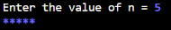

# Report: JOBSHEET 8 LOOPS 2

Name: Davina Tegar Putri Ervia

NIM: 264107020083

GitHub: https://github.com/davinategar

# 1. Learning Objectives

* Understand the concept of nested loops in algorithms
* Understand the flow of nested loops
* Recognize the syntax of nested loops
* Be able to apply nested loops to solve a simple case study.

# 2. Practicum

## 2.1 Experiment 1: Review of Loops 1

**Experiment Steps**

the code:

```
import java.util.Scanner;

public class Star07 {
    public static void main(String[] args) {
        Scanner sc = new Scanner(System.in);

        System.out.print("Enter the value of n = ");
        int n = sc.nextInt();

        for (int i = 1; i <= n; i++) {
            System.out.print("*");
        }
        System.out.println();

        sc.close();
    }
}
```

Result:


