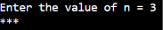
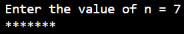
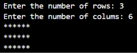
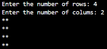
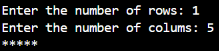

# Report: JOBSHEET 8 LOOPS 2

Name: Davina Tegar Putri Ervia

NIM: 264107020083

GitHub: https://github.com/davinategar

# 1. Learning Objectives

* Understand the concept of nested loops in algorithms
* Understand the flow of nested loops
* Recognize the syntax of nested loops
* Be able to apply nested loops to solve a simple case study.

# 2. Practicum

## 2.1 Experiment 1: Review of Loops 1

**Experiment Steps**

the code:

```
import java.util.Scanner;

public class Star07 {
    public static void main(String[] args) {
        Scanner sc = new Scanner(System.in);

        System.out.print("Enter the value of n = ");
        int n = sc.nextInt();

        for (int i = 1; i <= n; i++) {
            System.out.print("*");
        }
        System.out.println();

        sc.close();
    }
}
```

Result:






**Question**

1. If the initialization ```i = 1``` is changed to ```i = 0``` without changing the condition, how many ```*``` characters are printed when ```n = 5```? Explain.

Answer:

There will be 6 asterisk (*) characters printed. Because the loop starts from ```i = 0``` and continues while ```i <= 5```. So, the loop runs 6 times (0, 1, 2, 3, 4, 5).

2. If the condition i <= n is changed to i < n, how many times does the loop run whenn = 5? Why is the result different?

Answer:

The loop runs 4 times. Because the loop starts from ```i = 1``` and stops when ```i``` reaches 5. The condition ```i < 5``` means that ```i``` must be less than 5, so the loop only runs for 1, 2, 3, and 4. 

3. Predict the output of the following code fragment when n = 9, then verify it by replacingthe FOR loop in your program and running it.

```
for (int i = 2; i <= n; i += 2) {
    System.out.print(i + " ");
}
```

Answer:

The output: ```2 4 6 8```. The loop starts from 2 and increases by 2 each time. It prints only even numbers that do not exceed 9. 

Modify this code so that it prints the odd positive numbers that do not exceed n.

```
for (int i = 1; i <= n; i += 2) {
    System.out.print(i + " ");
}
```

Output when n = 9: ```1 3 5 7 9``` 

4. Explain why changing the increment ```i++``` to ```i--``` (with the condition still ```i <= n```) makes the loop run endlessly.

Answer:

Because ```i--``` decreases the value of ```i``` by 1 in every loop. The value of i becomes smaller and always satisfies the condition ```i <= n```.

## 2.2 Experiment 2: Rectangle Star Pattern (Nested FOR)

**Experiment Steps**

the code:

```
import java.util.Scanner;

public class Rectangle07 {
    public static void main(String[] args) {
        Scanner sc = new Scanner(System.in);

        System.out.print("Enter the number of rows: ");
        int rows = sc.nextInt();
        System.out.print("Enter the number of colums: ");
        int colums = sc.nextInt();

        for (int i = 1; i <= rows; i++) {
            for (int j = 1; j <= colums; j++) {
                System.out.print("*");
            }
            System.out.println();
        }
        sc.close();
    }
}
```

Result:







**Question**

1. Explain the function of the variables i and j in the program.

Answer:

* i is used as a counter for the outer loop. It controls the number of rows.
* j is used as a counter for the inner loop. It controls the number of columns.

The outer loop controls how many lines are printed, while the inner loop controls how many stars are printed in each line.

2. How many times are the outer loop, the inner loop, and the statement print("*") executed for rows = 4 and columns = 7?

Answer:

* Outer loop: 4 times.
* Inner loop: 28 times (4 × 7).
* ```System.out.print("*")```: 28 times.

The outer loop runs 4 times because there are 4 rows. For each row, the inner loop runs 7 times because there are 7 columns. Therefore, the print statement runs 28 times.

3. What happens if the bounds of the outer and inner loops are swapped (the outer loop uses columns and the inner loop uses rows)? Use rows = 3 and columns = 6 to explain.

Answer: 

The rectangle will have 6 rows and 3 columns instead of 3 rows and 6 columns.

```
***
***
***
***
***
***
```

The outer loop runs 6 times because it uses columns. The inner loop runs 3 times because it uses rows. Therefore, the rectangle becomes taller and narrower.

4. Explain the effect of removing System.out.println(); after the inner loop.

The stars will be printed in one continuous line without moving to a new line.

```System.out.println();``` moves the cursor to the next line after each row is printed. If it is removed, all stars will appear in one line. For example, with rows = 3 and columns = 4:

Without ```System.out.println();```:

```
************
```

## 2.3 Experiment 3: Debugging a Star Triangle – Nested WHILE

**Experiment Steps**

the code:
