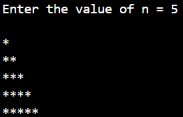
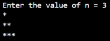
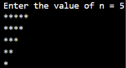

# Report: JOBSHEET 8 LOOPS 2

Name: Davina Tegar Putri Ervia

NIM: 264107020083

GitHub: https://github.com/davinategar

# 1. Learning Objectives

* Understand the concept of nested loops in algorithms
* Understand the flow of nested loops
* Recognize the syntax of nested loops
* Be able to apply nested loops to solve a simple case study.

# 2. Practicum

## 2.1 Experiment 1: Review of Loops 1

**Experiment Steps**

the code:

```
import java.util.Scanner;

public class Star07 {
    public static void main(String[] args) {
        Scanner sc = new Scanner(System.in);

        System.out.print("Enter the value of n = ");
        int n = sc.nextInt();

        for (int i = 1; i <= n; i++) {
            System.out.print("*");
        }
        System.out.println();

        sc.close();
    }
}
```

Result:


**Question**

1. If the initialization ```i = 1``` is changed to ```i = 0``` without changing the condition, how many ```*``` characters are printed when ```n = 5```? Explain.

Answer:

There will be 6 asterisk (*) characters printed. Because the loop starts from ```i = 0``` and continues while ```i <= 5```. So, the loop runs 6 times (0, 1, 2, 3, 4, 5).

2. If the condition i <= n is changed to i < n, how many times does the loop run whenn = 5? Why is the result different?

Answer:

The loop runs 4 times. Because the loop starts from ```i = 1``` and stops when ```i``` reaches 5. The condition ```i < 5``` means that ```i``` must be less than 5, so the loop only runs for 1, 2, 3, and 4. 

3. Predict the output of the following code fragment when n = 9, then verify it by replacingthe FOR loop in your program and running it.

```
for (int i = 2; i <= n; i += 2) {
    System.out.print(i + " ");
}
```

Answer:

The output: ```2 4 6 8```. The loop starts from 2 and increases by 2 each time. It prints only even numbers that do not exceed 9. 

Modify this code so that it prints the odd positive numbers that do not exceed n.

```
for (int i = 1; i <= n; i += 2) {
    System.out.print(i + " ");
}
```

Output when n = 9: ```1 3 5 7 9``` 

4. Explain why changing the increment ```i++``` to ```i--``` (with the condition still ```i <= n```) makes the loop run endlessly.

Answer:

Because ```i--``` decreases the value of ```i``` by 1 in every loop. The value of i becomes smaller and always satisfies the condition ```i <= n```.

## 2.2 Experiment 2: Rectangle Star Pattern (Nested FOR)

**Experiment Steps**

the code:

```
import java.util.Scanner;

public class Rectangle07 {
    public static void main(String[] args) {
        Scanner sc = new Scanner(System.in);

        System.out.print("Enter the number of rows: ");
        int rows = sc.nextInt();
        System.out.print("Enter the number of colums: ");
        int colums = sc.nextInt();

        for (int i = 1; i <= rows; i++) {
            for (int j = 1; j <= colums; j++) {
                System.out.print("*");
            }
            System.out.println();
        }
        sc.close();
    }
}
```

Result:


**Question**

1. Explain the function of the variables i and j in the program.

Answer:

* i is used as a counter for the outer loop. It controls the number of rows.
* j is used as a counter for the inner loop. It controls the number of columns.

The outer loop controls how many lines are printed, while the inner loop controls how many stars are printed in each line.

2. How many times are the outer loop, the inner loop, and the statement print("*") executed for rows = 4 and columns = 7?

Answer:

* Outer loop: 4 times.
* Inner loop: 28 times (4 × 7).
* ```System.out.print("*")```: 28 times.

The outer loop runs 4 times because there are 4 rows. For each row, the inner loop runs 7 times because there are 7 columns. Therefore, the print statement runs 28 times.

3. What happens if the bounds of the outer and inner loops are swapped (the outer loop uses columns and the inner loop uses rows)? Use rows = 3 and columns = 6 to explain.

Answer: 

The rectangle will have 6 rows and 3 columns instead of 3 rows and 6 columns.

```
***
***
***
***
***
***
```

The outer loop runs 6 times because it uses columns. The inner loop runs 3 times because it uses rows. Therefore, the rectangle becomes taller and narrower.

4. Explain the effect of removing System.out.println(); after the inner loop.

The stars will be printed in one continuous line without moving to a new line.

```System.out.println();``` moves the cursor to the next line after each row is printed. If it is removed, all stars will appear in one line. For example, with rows = 3 and columns = 4:

Without ```System.out.println();```:

```
************
```

## 2.3 Experiment 3: Debugging a Star Triangle – Nested WHILE

**Experiment Steps**

the code: 

```
import java.util.Scanner;

public class Triangle07 {
    public static void main(String[] args) {
        Scanner sc = new Scanner(System.in);

        System.out.print("Enter the value of n = ");
        int n = sc.nextInt();

        int i = 1;
        while (i <= n) {
            int j = 0;
            while (j < i) {
                System.out.print("*");
                j++;
            }
            System.out.println();
            i++;
        }

        sc.close();
    }
}
```

Result:





**5. Run the program again with n = 5, then observe the result:**

```
[i=0]
[i=1] *
[i=2] **
[i=3] ***
[i=4] ****
[i=5] *****
```

a. how many times does the outer loop run? Is this the same as the desired number ofrows? 

Answer: The outer loop runs 6 times, from ```i = 0``` to ```i = 5```. This is not the same as the desired 5 rows because the loop starts from 0.

b. How many * characters are printed when ```i = 0```?

Answer: Zero (*) characters are printed because the condition ```j < i``` is false when ```i = 0```.

c. Why are all the characters displayed on a single line?

Answer: Because there is no ```System.out.println();``` after the inner loop. The program does not move to a new line after printing each row.

**6. Fix the code one step at a time, and run the program after each fix:**

a. Add ```System.out.println();``` after the inner loop finishes, before ```i++```.

Output:

```
[i=0]

[i=1] *
[i=2] **
[i=3] ***
[i=4] ****
[i=5] *****
```

Answer: Yes, there is still one empty line because the outer loop starts from i = 0. When i = 0, no asterisk is printed.

b. Change the initialization and/or condition of the outer loop so that the loop runs exactly n times without any empty lines.

Change:

```
int i = 0;
while (i <= n) {
```

Into:

```
int i = 1;
while (i <= n) {
```

Answer: The initialization is changed from ```i = 0``` to ```i = 1```. This makes the loop run exactly 5 times and removes the empty line.

Output:

```
[i=1] *
[i=2] **
[i=3] ***
[i=4] ****
[i=5] *****
```

**7. Once the output matches the target output, delete the debug line(s).**

Delete this debug line:

```System.out.print("[i=" + i + "] ");```

Final code after removing the debug line:

```
import java.util.Scanner;

public class Triangle07 {
    public static void main(String[] args) {
        Scanner sc = new Scanner(System.in);

        System.out.print("Enter the value of n = ");
        int n = sc.nextInt();

        int i = 1;
        while (i <= n) {
            int j = 0;
            while (j < i) {
                System.out.print("*");
                j++;
            }
            System.out.println();
            i++;
        }

        sc.close();
    }
}
```

Answer: The debug line is removed because it is only used to check the value of i. The program now prints the correct triangle.


**8. Modify the program so that, after the triangle above is printed, it also prints an inverted triangle.**

Code for the inverted triangle:

```

import java.util.Scanner;

public class Triangle07 {
    public static void main(String[] args) {
        Scanner sc = new Scanner(System.in);

        System.out.print("Enter the value of n = ");
        int n = sc.nextInt();

        int i = n;
        while (i >= 1) {
            int j = 0;
            while (j < i) {
                System.out.print("*");
                j++;
            }
            System.out.println();
            i--;
        }

        sc.close();
    }
}
```

Result:



**Question**

1. Identify the mismatches in the initial output, and at least two fixes needed to produce anested triangle pattern.

Answer:

The initial output does not match the desired triangle pattern because all characters are printed on one line and there is an empty line at the beginning. Two fixes are needed:

* Add ```System.out.println();``` after the inner loop to move to a new line.
* Change the initialization from ```i = 0``` to ```i = 1``` to remove the empty first line.

2. Explain the roles of the variables i and j. Why must the value of j be reset to 0 in every iteration of the outer loop? What happens if j is not reset?

Answer:

* i controls the number of rows in the triangle.
* j controls the number of stars printed in each row.

The value of j must be reset to 0 in every iteration of the outer loop because each row needs to start counting from zero. If j is not reset, the inner loop will not print the correct number of stars because the value of j continues from the previous iteration.

3. Explain the changes to the initialization, the condition, and the update of the outer loop that are needed to form the inverted triangle.

Answer:

To create an inverted triangle, three changes are needed:

1. Initialization: Change ```i = 1``` to ```i = n``` so the triangle starts with the maximum number of stars.
2. Condition: Change ```i <= n``` to ```i >= 1``` so the loop continues until i reaches 1.
3. Update: Change ```i++``` to ```i--``` so the number of stars decreases by one in each row.

Example output when n = 5:


## 2.4 Experiment 4: Case Study of Group Project Scores

**Experiment Steps**

the code: 

```
import java.util.Scanner;

public class GroupScore07 {
    public static void main(String[] args) {
        Scanner sc = new Scanner(System.in);

        System.out.print("Enter the number of groups : ");
        int numGroups = sc.nextInt();
        System.out.print("Enter the number of graders: ");
        int numGraders = sc.nextInt();

        if (numGroups <= 0 || numGraders <= 0) {
            System.out.println("Groups and graders must be > 0.");
        } else {
            int groupNo = 1;
            double highestAverage = -1;
            int bestGroup = 0;

            while (groupNo <= numGroups) {
                System.out.println("Group " + groupNo);
                double totalScore = 0;

                for (int j = 1; j <= numGraders; j++) {
                    int score;
                    do {
                        System.out.print("  Score from Grader " + j + ": ");
                        score = sc.nextInt();
                        if (score < 0 || score > 100) {
                            System.out.println("  Score must be 0-100. Retry!");
                        }
                    } while (score < 0 || score > 100);
                    totalScore += score;
                }

                double averageScore = totalScore / numGraders;
                System.out.println("Group " + groupNo
                        + ": average score = " + averageScore);

                if (averageScore > highestAverage) {
                    highestAverage = averageScore;
                    bestGroup = groupNo;
                }

                groupNo++;
            }

            System.out.println("==============================");
            System.out.println("Best group      : " + bestGroup);
            System.out.println("Highest average : " + highestAverage);
        }

        sc.close();
    }
}
```

Result:

